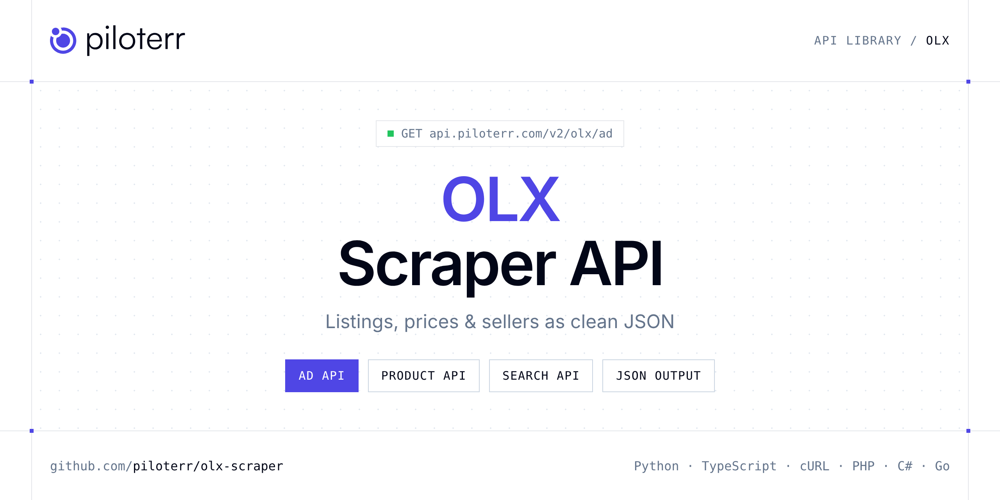

<p align="center">
  <a href="https://www.piloterr.com"></a>
</p>

# OLX Scraper API

[](https://discord.gg/CFj3ph8aHU) [](https://app.piloterr.com) [](https://app.piloterr.com/openapi) [](LICENSE)

The **Piloterr OLX Scraper API** lets you extract public data from OLX as **clean, structured JSON** — no proxies, headless browsers or HTML parsing to maintain. Endpoints available in production:

- **OLX Ad API** — Read one OLX ad from its id or URL.
- **OLX Product API** — Read one OLX ad from its id or URL.
- **OLX Search API** — Search OLX Brazil classifieds by keyword and get title, price, location, seller type, and condition as structured JSON in real time.

Use it for listing monitoring, price benchmarks, stock sourcing or market analytics on second-hand and vehicle marketplaces.

| Endpoint | Path | Credits | What you get |
|---|---|---|---|
| [OLX Ad API](#olx-ad-api) | `/v2/olx/ad` | 1 | Read one OLX ad from its id or URL. You get the asking price, the city, and the seller name. |
| [OLX Product API](#olx-product-api) | `/v2/olx/product` | 1 | Read one OLX ad from its id or URL. You get the asking price, the city, and the seller name. |
| [OLX Search API](#olx-search-api) | `/v2/olx/search` | 1 | Search OLX Brazil classifieds by keyword and get title, price, location, seller type, and condition as structured JSON in real time. |

## Table of contents

- [How it works](#how-it-works)
- [OLX Ad API](#olx-ad-api)
- [OLX Product API](#olx-product-api)
- [OLX Search API](#olx-search-api)
- [Code examples in other languages](#code-examples-in-other-languages)
- [Practical use cases](#practical-use-cases)
- [Why Piloterr?](#why-piloterr)
- [FAQ](#faq)
- [Related scrapers](#related-scrapers)
- [Support](#support)

## How it works

1. **Create a free Piloterr account** and copy your API key from the [dashboard](https://app.piloterr.com).
2. **Send a `GET` (or `POST`) request** to `https://api.piloterr.com/v2/...` with the header `x-api-key: YOUR_API_KEY`.
3. **Receive structured JSON** — Piloterr handles rendering, proxies, retries and parsing.

```bash
export PILOTERR_API_KEY="your-api-key"
pip install requests        # Python
# TypeScript: Node.js 18+ (native fetch), run with `npx tsx file.ts`
```

> Every endpoint accepts both `GET` (query string) and `POST` (JSON body with the same fields).

## OLX Ad API

Read one OLX ad from its id or URL. You get the asking price, the city, and the seller name.

`GET | POST https://api.piloterr.com/v2/olx/ad` · **1 credit per request** · [Full reference](https://app.piloterr.com/openapi)

### Request parameters

| Parameter | Type | Required | Description |
|---|---|---|---|
| `query` | string | ✅ | OLX listing URL. |
| `region` | string | — | Ignored when query is a full URL. The host selects the country. |
| `return_page_source` | boolean | — | When true, return raw HTML. |

### Python example

```python
import json
import os
import requests

response = requests.get(
    "https://api.piloterr.com/v2/olx/ad",
    headers={"x-api-key": os.environ["PILOTERR_API_KEY"]},
    params={
        "query": "https://www.olx.pl/d/oferta/apple-iphone-17-pro-256-gb-nowy-szczecin-zaplombowany-karta-sim-ul-baluki-4-szczecin-CID99-ID18Acsd.html",
    },
    timeout=120,
)
response.raise_for_status()
data = response.json()

print(json.dumps(data, indent=2, ensure_ascii=False)[:2000])
```

### TypeScript example

```typescript
type OlxAd = {
  id?: number;
  url?: string;
  image?: string;
  price?: number;
  title?: string;
  images?: string[];
  region?: string;
  status?: string;
  currency?: string;
  latitude?: number;
  location?: {
    city?: string;
    region?: string;
    district?: string;
  };
  condition?: string;
  longitude?: number;
  seller_id?: number;
  created_at?: string;
  negotiable?: boolean;
  parameters?: {
    name?: string;
    value?: string;
  }[];
  breadcrumbs?: {
    url?: string;
    name?: string;
  }[];
  description?: string;
  is_business?: boolean;
  is_promoted?: boolean;
  seller_name?: string;
  refreshed_at?: string;
  price_display?: string;
};

const params = new URLSearchParams({
  "query": "https://www.olx.pl/d/oferta/apple-iphone-17-pro-256-gb-nowy-szczecin-zaplombowany-karta-sim-ul-baluki-4-szczecin-CID99-ID18Acsd.html",
});

const response = await fetch(`https://api.piloterr.com/v2/olx/ad?${params}`, {
  headers: { "x-api-key": process.env.PILOTERR_API_KEY! },
});
if (!response.ok) throw new Error(`Piloterr error ${response.status}: ${await response.text()}`);

const data = (await response.json()) as OlxAd;

console.log(JSON.stringify(data, null, 2).slice(0, 2000));
```

<details>
<summary><b>POST variant</b></summary>

```http
POST https://api.piloterr.com/v2/olx/ad
x-api-key: YOUR_API_KEY
Content-Type: application/json

{"query": "https://www.olx.pl/d/oferta/apple-iphone-17-pro-256-gb-nowy-szczecin-zaplombowany-karta-sim-ul-baluki-4-szczecin-CID99-ID18Acsd.html"}
```
</details>

### Output example

Example response from the API reference, abridged — real values depend on the page you scrape.

```json
{
  "id": 1042971205,
  "url": "https://www.olx.pl/d/oferta/apple-iphone-17-pro-256-gb-nowy-szczecin-zaplombowany-karta-sim-ul-baluki-4-szczecin-CID99-ID18Acsd.html",
  "image": "https://ireland.apollo.olxcdn.com:443/v1/files/u7efs2w88qtt-PL/image;s=3024x4032",
  "price": 4999,
  "title": "Apple iPhone 17 Pro 256 Gb NOWY Szczecin Zaplombowany Karta sim | ul. Bałuki 4 Szczecin",
  "images": [
    "https://ireland.apollo.olxcdn.com:443/v1/files/u7efs2w88qtt-PL/image;s=3024x4032",
    "https://ireland.apollo.olxcdn.com:443/v1/files/dcr4lxvv6iy5-PL/image;s=1254x1254"
  ],
  "region": "pl",
  "status": "active",
  "currency": "PLN",
  "latitude": 53.43138,
  "location": {
    "city": "Szczecin",
    "region": "Zachodniopomorskie",
    "district": "Centrum"
  },
  "condition": "Nowe",
  "longitude": 14.54948,
  "seller_id": 25081589,
  "created_at": "2025-12-06T18:02:46+01:00",
  "negotiable": false,
  "parameters": [
    {
      "name": "Stan",
      "value": "Nowe"
    },
    {
      "name": "Model telefonu",
      "value": "iPhone 17 Pro"
    }
  ],
  "breadcrumbs": [
    {
      "url": "https://www.olx.pl/",
      "name": "Strona główna"
    },
    {
      "url": "https://www.olx.pl/elektronika/",
      "name": "Elektronika"
    }
  ],
  "description": "Apple iPhone 17 Pro 256 GB – , oryginalny produkt Apple Prezentowany telefon to w 100% oryginalny produkt firmy Apple. Urządzenie jest no…",
  "is_business": true,
  "is_promoted": true,
  "seller_name": "example",
  "refreshed_at": "2026-10-14T22:54:22+02:00",
  "price_display": "4 999 zł"
}
```

### Response fields

| Field | Type | Description |
|---|---|---|
| `id` | integer |  |
| `url` | string |  |
| `image` | string |  |
| `price` | integer |  |
| `title` | string |  |
| `images` | string[] |  |
| `region` | string |  |
| `status` | string |  |
| `currency` | string |  |
| `latitude` | number |  |
| `location` | object |  |
| `location.city` | string |  |
| `location.region` | string |  |
| `location.district` | string |  |
| `condition` | string |  |
| `longitude` | number |  |
| `seller_id` | integer |  |
| `created_at` | string |  |
| `negotiable` | boolean |  |
| `parameters[]` | object[] |  |
| `parameters[].name` | string |  |
| `parameters[].value` | string |  |
| `breadcrumbs[]` | object[] |  |
| `breadcrumbs[].url` | string |  |
| `breadcrumbs[].name` | string |  |

## OLX Product API

Read one OLX ad from its id or URL. You get the asking price, the city, and the seller name.

`GET | POST https://api.piloterr.com/v2/olx/product` · **1 credit per request** · [Full reference](https://app.piloterr.com/openapi)

### Request parameters

| Parameter | Type | Required | Description |
|---|---|---|---|
| `query` | string | ✅ | Full URL of the OLX listing page to retrieve. Must be a valid olx.com.br listing URL. **Example 1:** |

### Python example

```python
import json
import os
import requests

response = requests.get(
    "https://api.piloterr.com/v2/olx/product",
    headers={"x-api-key": os.environ["PILOTERR_API_KEY"]},
    params={
        "query": "https://www.olx.com.br/eletronicos-e-celulares/celulares-e-smartphones/iphone-14-128gb-como-novo-IDJ4mBb.html",
    },
    timeout=120,
)
response.raise_for_status()
data = response.json()

print(json.dumps(data, indent=2, ensure_ascii=False)[:2000])
```

### TypeScript example

```typescript
type OlxProduct = {
  id?: string;
  url?: string;
  price?: number;
  title?: string;
  views?: number;
  images?: string[];
  seller?: {
    id?: string;
    name?: string;
    type?: string;
    total_ads?: number;
    profile_url?: string;
    member_since?: string;
  };
  status?: string;
  payment?: {
    installments?: {
      amount?: number;
      quantity?: number;
    };
    free_shipping?: boolean;
    online_payment?: boolean;
  };
  category?: string;
  location?: {
    lat?: number;
    lng?: number;
    city?: string;
    state?: string;
    neighborhood?: string;
  };
  condition?: string;
  thumbnail?: string;
  attributes?: {
    label?: string;
    value?: string;
  }[];
  updated_at?: string;
  category_id?: string;
  description?: string;
  published_at?: string;
  original_price?: number;
};

const params = new URLSearchParams({
  "query": "https://www.olx.com.br/eletronicos-e-celulares/celulares-e-smartphones/iphone-14-128gb-como-novo-IDJ4mBb.html",
});

const response = await fetch(`https://api.piloterr.com/v2/olx/product?${params}`, {
  headers: { "x-api-key": process.env.PILOTERR_API_KEY! },
});
if (!response.ok) throw new Error(`Piloterr error ${response.status}: ${await response.text()}`);

const data = (await response.json()) as OlxProduct;

console.log(JSON.stringify(data, null, 2).slice(0, 2000));
```

<details>
<summary><b>POST variant</b></summary>

```http
POST https://api.piloterr.com/v2/olx/product
x-api-key: YOUR_API_KEY
Content-Type: application/json

{"query": "https://www.olx.com.br/eletronicos-e-celulares/celulares-e-smartphones/iphone-14-128gb-como-novo-IDJ4mBb.html"}
```
</details>

### Output example

Example response from the API reference, abridged — real values depend on the page you scrape.

```json
{
  "id": "902901124",
  "url": "https://www.olx.com.br/eletronicos-e-celulares/celulares-e-smartphones/iphone-14-128gb-como-novo-IDJ4mBb.html",
  "price": 3200,
  "title": "iPhone 14 128GB Como Novo",
  "views": 847,
  "images": [
    "https://img.olx.com.br/images/902901124_1.jpg",
    "https://img.olx.com.br/images/902901124_2.jpg"
  ],
  "seller": {
    "id": "example",
    "name": "example",
    "type": "example",
    "total_ads": 0,
    "profile_url": "example",
    "member_since": "example"
  },
  "status": "active",
  "payment": {
    "installments": {
      "amount": 1066.67,
      "quantity": 3
    },
    "free_shipping": false,
    "online_payment": true
  },
  "category": "Celulares e Smartphones",
  "location": {
    "lat": -23.5629,
    "lng": -46.6861,
    "city": "São Paulo",
    "state": "SP",
    "neighborhood": "Pinheiros"
  },
  "condition": "usado",
  "thumbnail": "https://img.olx.com.br/images/902901124_1_thumb.jpg",
  "attributes": [
    {
      "label": "Marca",
      "value": "Apple"
    },
    {
      "label": "Modelo",
      "value": "iPhone 14"
    }
  ],
  "updated_at": "2026-04-30T09:10:00.000Z",
  "category_id": "3486",
  "description": "Vendo iPhone 14 128GB na cor preta, em ótimo estado de conservação. Sem arranhões, bateria com 89% de saúde. Acompanha caixa original, ca…",
  "published_at": "2026-04-29T14:35:00.000Z",
  "original_price": 3800
}
```

### Response fields

| Field | Type | Description |
|---|---|---|
| `id` | string |  |
| `url` | string |  |
| `price` | integer |  |
| `title` | string |  |
| `views` | integer |  |
| `images` | string[] |  |
| `seller` | object |  |
| `seller.id` | string |  |
| `seller.name` | string |  |
| `seller.type` | string |  |
| `seller.total_ads` | integer |  |
| `seller.profile_url` | string |  |
| `seller.member_since` | string |  |
| `status` | string |  |
| `payment` | object |  |
| `payment.installments` | object |  |
| `payment.free_shipping` | boolean |  |
| `payment.online_payment` | boolean |  |
| `category` | string |  |
| `location` | object |  |
| `location.lat` | number |  |
| `location.lng` | number |  |
| `location.city` | string |  |
| `location.state` | string |  |
| `location.neighborhood` | string |  |

## OLX Search API

Search OLX Brazil classifieds by keyword and get title, price, location, seller type, and condition as structured JSON in real time.

`GET | POST https://api.piloterr.com/v2/olx/search` · **1 credit per request** · [Full reference](https://app.piloterr.com/openapi)

### Request parameters

| Parameter | Type | Required | Description |
|---|---|---|---|
| `query` | string | ✅ | Search keyword or phrase, as you would type it in the OLX search bar. Supports Portuguese terms for Brazilian inventory. |
| `category` | string | — | OLX category slug to restrict results to a specific vertical. Common values: |
| `state` | string | — | Brazilian state abbreviation to filter results geographically. |
| `city` | string | — | City slug to narrow results to a specific municipality. Use lowercase with hyphens. |
| `min_price` | number | — | Minimum listing price in BRL. |
| `max_price` | number | — | Maximum listing price in BRL. |
| `seller_type` | string | — | Filter by seller type. |
| `sort` | string | — | Sort order for results. |
| `page` | number | — | Page number for paginated results. **Default: 1.** |

### Python example

```python
import json
import os
import requests

response = requests.get(
    "https://api.piloterr.com/v2/olx/search",
    headers={"x-api-key": os.environ["PILOTERR_API_KEY"]},
    params={
        "query": "iphone 14",
    },
    timeout=120,
)
response.raise_for_status()
data = response.json()

print(json.dumps(data, indent=2, ensure_ascii=False)[:2000])
```

### TypeScript example

```typescript
type OlxSearch = {
  page?: number;
  results?: {
    id?: string;
    url?: string;
    price?: number;
    title?: string;
    images?: string[];
    category?: string;
    featured?: boolean;
    location?: {
      city?: string;
      state?: string;
    };
    condition?: string;
    thumbnail?: string;
    category_id?: string;
    seller_type?: string;
    installments?: {
      amount?: number;
      quantity?: number;
    };
    published_at?: string;
    free_shipping?: boolean;
    original_price?: number;
  }[];
  total_results?: number;
  results_per_page?: number;
};

const params = new URLSearchParams({
  "query": "iphone 14",
});

const response = await fetch(`https://api.piloterr.com/v2/olx/search?${params}`, {
  headers: { "x-api-key": process.env.PILOTERR_API_KEY! },
});
if (!response.ok) throw new Error(`Piloterr error ${response.status}: ${await response.text()}`);

const data = (await response.json()) as OlxSearch;

console.log(JSON.stringify(data, null, 2).slice(0, 2000));
```

<details>
<summary><b>POST variant</b></summary>

```http
POST https://api.piloterr.com/v2/olx/search
x-api-key: YOUR_API_KEY
Content-Type: application/json

{"query": "iphone 14"}
```
</details>

### Output example

Example response from the API reference, abridged — real values depend on the page you scrape.

```json
{
  "page": 1,
  "results": [
    {
      "id": "902901124",
      "url": "https://www.olx.com.br/eletronicos-e-celulares/celulares-e-smartphones/iphone-14-128gb-como-novo-IDJ4mBb.html",
      "price": 3200,
      "title": "iPhone 14 128GB Como Novo",
      "images": [
        "https://img.olx.com.br/images/902901124_1.jpg",
        "https://img.olx.com.br/images/902901124_2.jpg"
      ],
      "category": "Celulares e Smartphones",
      "featured": false,
      "location": {
        "city": "São Paulo",
        "state": "SP"
      },
      "condition": "usado",
      "thumbnail": "https://img.olx.com.br/images/902901124_1_thumb.jpg",
      "category_id": "3486",
      "seller_type": "particular",
      "installments": {
        "amount": 1066.67,
        "quantity": 3
      },
      "published_at": "2026-04-29T14:35:00.000Z",
      "free_shipping": false,
      "original_price": 3800
    },
    {
      "id": "893412874",
      "url": "https://www.olx.com.br/iphone-14-pro-256gb-roxo-lacrado-IDJ2kPr.html",
      "price": 4900,
      "title": "iPhone 14 Pro 256GB Roxo Lacrado",
      "images": [
        "https://img.olx.com.br/images/893412874_1.jpg",
        "https://img.olx.com.br/images/893412874_2.jpg"
      ],
      "category": "Celulares e Smartphones",
      "featured": true,
      "location": {
        "city": "Rio de Janeiro",
        "state": "RJ"
      },
      "condition": "novo",
      "thumbnail": "https://img.olx.com.br/images/893412874_1_thumb.jpg",
      "category_id": "3486",
      "seller_type": "profissional",
      "installments": {
        "amount": 490,
        "quantity": 10
      },
      "published_at": "2026-04-29T10:12:00.000Z",
      "free_shipping": true,
      "original_price": null
    }
  ],
  "total_results": 8432,
  "results_per_page": 25
}
```

### Response fields

| Field | Type | Description |
|---|---|---|
| `page` | integer |  |
| `results[]` | object[] |  |
| `results[].id` | string |  |
| `results[].url` | string |  |
| `results[].price` | integer |  |
| `results[].title` | string |  |
| `results[].images` | string[] |  |
| `results[].category` | string |  |
| `results[].featured` | boolean |  |
| `results[].location` | object |  |
| `results[].condition` | string |  |
| `results[].thumbnail` | string |  |
| `results[].category_id` | string |  |
| `results[].seller_type` | string |  |
| `results[].installments` | object |  |
| `results[].published_at` | string |  |
| `results[].free_shipping` | boolean |  |
| `results[].original_price` | integer |  |
| `total_results` | integer |  |
| `results_per_page` | integer |  |

## Code examples in other languages

Ready-to-run examples live in the [`examples/`](examples) folder. Each one reads your key from the `PILOTERR_API_KEY` environment variable.

| Language | Ad | Product | Search |
|---|---|---|---|
| cURL (Bash) | [`ad`](examples/curl/ad.sh) | [`product`](examples/curl/product.sh) | [`search`](examples/curl/search.sh) |
| PHP | [`ad`](examples/php/ad.php) | [`product`](examples/php/product.php) | [`search`](examples/php/search.php) |
| C# | [`ad`](examples/csharp/Ad.cs) | [`product`](examples/csharp/Product.cs) | [`search`](examples/csharp/Search.cs) |
| Go | [`ad`](examples/go/ad.go) | [`product`](examples/go/product.go) | [`search`](examples/go/search.go) |
| Java | [`ad`](examples/java/AdExample.java) | [`product`](examples/java/ProductExample.java) | [`search`](examples/java/SearchExample.java) |
| Ruby | [`ad`](examples/ruby/ad.rb) | [`product`](examples/ruby/product.rb) | [`search`](examples/ruby/search.rb) |
| Node.js | [`ad`](examples/nodejs/ad.mjs) | [`product`](examples/nodejs/product.mjs) | [`search`](examples/nodejs/search.mjs) |

## Practical use cases

- **Listing monitoring** — Get alerted when new ads matching your criteria are published.
- **Price benchmarks** — Compute market prices per model, category or location.
- **Sourcing** — Find stock, vehicles, parts or equipment faster than manual browsing.
- **Market analytics** — Measure supply, turnover and pricing trends over time.
- **Data products** — Feed valuation models and dashboards with structured listings.

## Why Piloterr?

- **No infrastructure** — no proxies, headless browsers or CAPTCHA solving to run yourself.
- **Structured JSON** — stable, documented fields instead of brittle HTML selectors.
- **Pay per request** — transparent credit cost per endpoint, failed requests are retried for you.
- **One API key, hundreds of sources** — OLX plus many other e-commerce, search and company data endpoints in the [Piloterr library](https://www.piloterr.com/library).
- **Any language** — plain HTTPS + JSON, with examples for Python, TypeScript, cURL, PHP, C#, Go, Java, Ruby and Node.js.

## FAQ

### Is it legal to scrape OLX?

Collecting publicly available data is generally allowed in many jurisdictions, but rules depend on your country, the data you collect and how you use it. Avoid personal data unless you have a lawful basis, respect the website's terms where they apply, and get legal advice for your specific use case. This is not legal advice.

### Do I need proxies or a headless browser?

No. Piloterr handles rendering, proxy rotation and retries on its side. You only send an HTTPS request with your `x-api-key` header and receive JSON.

### How much does a request cost?

Credits per call: `/v2/olx/ad` **1**, `/v2/olx/product` **1**, `/v2/olx/search` **1**. See the [Piloterr website](https://www.piloterr.com) for plans.

### What data does the OLX API return?

Each endpoint returns structured JSON: **OLX Ad** — `id`, `url`, `image`, `price`, `title`, `images`; **OLX Product** — `id`, `url`, `price`, `title`, `views`, `images`; **OLX Search** — `page`, `results[]`, `results[].id`, `results[].url`, `results[].price`, `results[].title`.

### How do I paginate OLX results?

Use the `page` parameter and keep requesting while the response indicates more results.

### Can I target a specific country or language?

Yes, use `region` — see the parameter tables above for accepted values.

### Can I get the raw HTML instead of JSON?

Yes. Set `return_page_source=true` and the response becomes `{"result": "..."}` with the page source.

### Which languages are supported?

Any language that can make an HTTP request. This README shows Python and TypeScript; the [`examples/`](examples) folder contains cURL, PHP, C#, Go, Java, Ruby and Node.js.

## Related scrapers

- [AutoScout24 Scraper API](https://github.com/piloterr/autoscout24-scraper)
- [Autotrader Scraper API](https://github.com/piloterr/autotrader-scraper)
- [Copart Scraper API](https://github.com/piloterr/copart-scraper)
- [Kijiji Scraper API](https://github.com/piloterr/kijiji-scraper)
- [Leboncoin Scraper API](https://github.com/piloterr/leboncoin-scraper)
- [Mascus Scraper API](https://github.com/piloterr/mascus-scraper)
- [All Piloterr scrapers on GitHub](https://github.com/piloterr)

## Support

- 💬 Join the [Piloterr Discord](https://discord.gg/CFj3ph8aHU) to ask questions and share what you build.
- 📚 Browse the [API reference (OpenAPI)](https://app.piloterr.com/openapi) and the [Piloterr library](https://www.piloterr.com/library).
- 🔑 [Get your API key](https://app.piloterr.com).

---

<p align="center">
  <a href="https://www.piloterr.com">
    <picture>
      <source media="(prefers-color-scheme: dark)" srcset="images/logo-dark.svg">
      
    </picture>
  </a>
  <br>
  <sub>Built by <a href="https://www.piloterr.com">Piloterr</a> — web scraping APIs for e-commerce, search, real estate and more, one API key.</sub>
</p>

<sub>OLX is a trademark of its respective owner. This repository is not affiliated with or endorsed by OLX. Examples are released under the MIT license.</sub>
